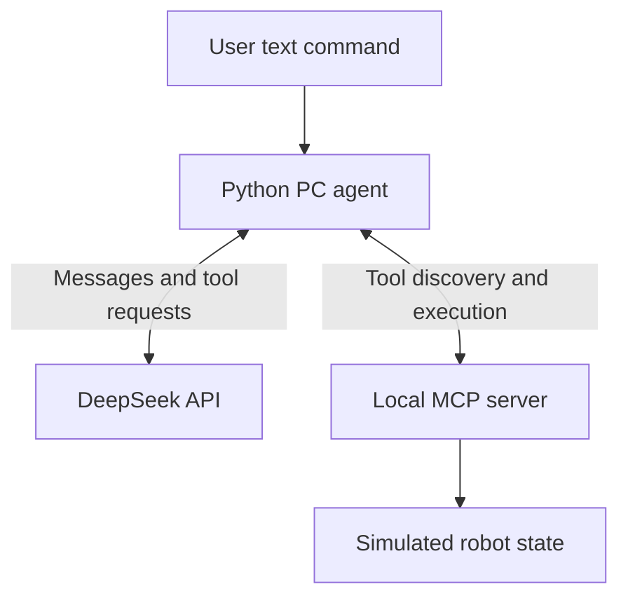

<div align="center">

# LiAo v1.0

### A personal AI robotics project built around tools, perception, and action.

**Raspberry Pi 4B · Python · MCP · DeepSeek · ESP32**

**Version 1.0 · In development · Developed by Li Ao**

Develop on your PC. Validate each component. Bring the robot to life on Raspberry Pi.

[Quick Start](#quick-start--windows-pc) · [Architecture](#how-it-works) · [Hardware](#hardware-platform) · [Roadmap](#roadmap)

</div>

---

## About LiAo

LiAo v1.0 is my AI robotics project, developed step by step to bring
natural-language interaction and practical robot control together.

LiAo connects language-model decisions
to clearly defined robot tools through the **Model Context Protocol (MCP)**.

The project includes a Raspberry Pi motor-and-camera server and a separate PC
simulation server. The PC agent uses **DeepSeek** to interpret a text request,
select a tool, inspect its result, and explain what happened.

The hardware workflow uses **Claude Code** as the MCP client. The
DeepSeek PC workflow runs independently of Claude Code and does not require its
installation.

> **Current milestone:** English and Bangla text commands have successfully
> completed the DeepSeek → MCP → simulated movement → response loop on Windows.
> Physical movement, camera integration, and spoken conversation are separate
> milestones; this PC demo does not verify them.

## What works today

| Capability | Current implementation |
| --- | --- |
| Natural-language commands | DeepSeek text agent with English and Bangla commands demonstrated |
| Tool discovery | Python MCP client discovers tools from a local subprocess |
| PC movement simulation | Bounded forward, backward, left, and right actions; simulated stop |
| Result-based replies | Tool results are returned to the model before its final answer |
| Raspberry Pi motor commands | USB serial adapter for an ESP32/Arduino motor controller; requires matching firmware |
| Raspberry Pi camera snapshots | Hardware MCP tool invokes `rpicam-jpeg`; requires a working Pi camera setup |
| Encoder interface | Serial parser receives four encoder counters; calibration is needed for distance estimates |
| Unit tests | Offline tests cover simulation bounds, cancellation, and the agent tool-result loop |

**Not implemented in the PC demo:** live camera capture, physical encoder
measurements, microphone input, speech synthesis, obstacle avoidance, or autonomous
navigation. The camera and encoder tools explicitly report that data is unavailable.

## How it works

### PC development workflow



The API proposes a tool call; the local application executes it. The model does
not directly access motors, serial ports, or the operating system.

### Raspberry Pi hardware workflow

Claude Code connects to `servers/robot_server.py` through `.mcp.json`. The server
exposes motor and camera functions. Motor commands travel over USB serial to an
ESP32/Arduino; camera snapshots use the Raspberry Pi camera software.

The DeepSeek PC runner always launches `servers/pc_robot_server.py`. It does not
switch to the physical server when an environment variable changes.

## What's included

| File | Purpose |
| --- | --- |
| `CLAUDE.md` | Identity, hardware context, and instructions for the Claude Code workflow |
| `.mcp.json` | MCP server launch configuration for Claude Code |
| `servers/robot_server.py` | MCP tools for the physical motor controller and Pi camera |
| `hardware/motor.py` | USB serial commands and encoder feedback parser |
| `servers/pc_robot_server.py` | Separate MCP server that simulates movement without opening hardware |
| `scripts/run_pc_agent.py` | DeepSeek chat, tool discovery, bounded tool execution, and result handling |
| `requirements-pc.txt` | Dependencies for the PC agent and MCP v1 API |
| `tests/test_pc_agent.py` | Offline unit tests for the agent and simulated robot |
| `PC_DEEPSEEK_SETUP.md` | Additional PC setup instructions and troubleshooting |

> **Configuration compatibility:** the current runner uses `SARAS_MODE` and
> `SARAS_MOTORS_ENABLED`. Keep these variable names until their matching code is
> updated; README branding alone does not rename runtime identifiers.

## Quick Start — Windows PC

Run these commands in **Git Bash**, from the project root.

### 1. Create and activate a Python environment

Use Python 3.10 or newer. The current Windows demo was exercised with Python 3.12.

```bash
python -m venv .venv
source .venv/Scripts/activate
```

If `.venv` already exists, activate it without recreating it.

### 2. Install dependencies

```bash
python -m pip install -r requirements-pc.txt
python -m pip check
```

The project currently uses **MCP v1** (`mcp>=1.28,<2`). Installing an unrestricted
MCP version can break the existing `mcp.server.fastmcp` import.

### 3. Configure `.env`

Create `.env` in the project root:

```dotenv
# DeepSeek connection
DEEPSEEK_API_KEY=replace_with_your_real_deepseek_key
DEEPSEEK_BASE_URL=https://api.deepseek.com
DEEPSEEK_MODEL=deepseek-flash
DEEPSEEK_TIMEOUT_SECONDS=60

# Keep this milestone in PC simulation
SARAS_MODE=simulation
SARAS_MOTORS_ENABLED=false
```

Replace the API key placeholder locally. Keep `.env` out of Git. Paste only the
configuration lines into the file, without Markdown code fences or a file list.
Process environment values take precedence over `.env`.

### 4. Check the local connection

```bash
python scripts/run_pc_agent.py --list-tools
```

### 5. Run an offline simulated action

```bash
python scripts/run_pc_agent.py --offline-demo
```

This launches the PC MCP server and simulates a half-second forward movement.
It does not call DeepSeek or require an API key. The result must identify the
action as simulated and report `physical_motion: false`.

### 6. Start the AI agent

```bash
python scripts/run_pc_agent.py
```

Try an English command:

```text
Move forward for half a second, then tell me what happened.
```

Or a Bangla command:

```text
বাম দিকে আধা সেকেন্ড ঘোরো, তারপর থামো।
```

The terminal displays the requested tool, its result, and the model's reply.
Type `q` to exit. Live chat requires internet access and uses your DeepSeek API
account balance. This milestone produces text output, not speech.

## Robot tools

| Tool | Physical server | PC simulation server |
| --- | --- | --- |
| `move(direction, speed, duration)` | Sends left/right motor commands over serial | Simulates a bounded movement |
| `stop()` | Sends the controller's stop command | Stops simulated movement |
| `get_encoders()` | Returns the last four received encoder counts | Reports measurements unavailable |
| `reset_encoders()` | Sends `RESET` and clears cached counts | Acknowledges that no real counters exist |
| `capture_image()` | Saves a Pi camera image to `/tmp/frame.jpg` | Reports camera capture unavailable |

The PC server accepts integer speeds from `0` to `255` and durations from `0.05`
to `1` second. Continuous movement is disabled there. Its tool names are
allowlisted by the agent, with a maximum of six model rounds and eight tool calls
per user turn. Failed requests are not automatically retried.

## Hardware platform

The intended main computer is a **Raspberry Pi 4 Model B**. The following hardware
list is a reference build configuration. Integration status is shown separately
so planned hardware is not confused with working software features.

| Component | Reference hardware | Repository coverage |
| --- | --- | --- |
| Main computer | Raspberry Pi 4B | Target for the original hardware server |
| CSI camera | Raspberry Pi Camera Module 3 | Snapshot command through `rpicam-jpeg` |
| Motor controller | ESP32 microcontroller | Host-side serial protocol; firmware must be supplied separately |
| Drive motors | Four JGA25 DC motors with encoders | Left/right speed commands and four-counter feedback format |
| Motor driver | Dual-channel H-bridge, reference specification 5–12 V / 0–30 A | Driver selection, wiring, and electrical suitability require verification |
| LiDAR | LDROBOT LD06 | No driver or processing module included |
| ToF sensor | DFRobot VL53L7CX, 8×8 grid | No driver or obstacle-avoidance integration included |
| Display | 7-inch HDMI display | No face/display application included in this starter |
| Microphone and speaker | USB omnidirectional microphone and USB speaker | Voice pipeline not included |
| Additional camera | USB webcam | No webcam adapter included |
| Power | 18650 cells in a 3S2P arrangement with a BMS | Electrical design is external to the software |
| Mechanical assembly | Fusion 360 chassis, 3D-printed parts, heat-set inserts | Build references; CAD files are not included |

## Serial protocol

The controller firmware must understand these commands at **115200 baud**:

```text
M <left> <right>          Set left/right signed motor commands, -255..255
S                         Stop the motors
RESET                     Reset encoder counters
ENC:<m1>:<m2>:<m3>:<m4>   Encoder feedback sent by the microcontroller
```

The Python adapter groups movement into left and right sides while receiving four
encoder counters. The firmware must define how those commands map to its actual
motors and pins. Encoder ticks alone are not a calibrated distance measurement.

**ESP32/Arduino firmware is not included.** Python installation alone cannot make
the physical motors work.

## Raspberry Pi setup — original hardware path

The hardware path requires a compatible Raspberry Pi OS environment,
a functioning Pi camera installation, matching controller firmware, and a
Claude Code installation with valid access if using that client.

1. Create a Python virtual environment and install the shared dependencies:

   ```bash
   python3 -m venv .venv
   source .venv/bin/activate
   python -m pip install -r requirements-pc.txt
   ```

2. Check the actual serial device and update the default port in
   `hardware/motor.py` if necessary. Common Pi paths include `/dev/ttyUSB0` and
   `/dev/ttyACM0`; the correct port and permissions depend on the connected device.

3. Verify the camera independently, once Raspberry Pi camera utilities are installed:

   ```bash
   rpicam-jpeg -o /tmp/test.jpg
   ```

4. Review `.mcp.json`. Use this Pi environment's Python executable and the correct
   server path; a Windows absolute path will not work on Raspberry Pi.

5. After installing and authenticating Claude Code, launch it from the project root:

   ```bash
   claude
   ```

6. First request tool discovery without executing tools. Camera and motor tests
   follow only after the relevant hardware and safety checks are complete.

This section describes the hardware route, not an automatic physical deployment
of the DeepSeek PC runner. A DeepSeek-to-physical-server adapter remains future work.

## Movement safety

The current physical server is an early prototype. Its `move()` implementation
allows continuous movement when duration is zero, raises some low requested
speeds to a minimum, and does not enforce a maximum speed in code. Its timed stop
also needs a guaranteed cleanup path. Prompt instructions do not enforce these
limits, and the current `stop()` tool is not a certified emergency stop.

Before enabling physical motion:

- Enforce speed and duration limits locally, including guaranteed stop paths.
- Implement a controller-side communication watchdog and verify its behavior.
- Validate motor power, wiring, direction, and controller command handling.
- Start with wheels raised and an independent way to disconnect motor power.
- Add independent sensing before attempting obstacle avoidance or autonomous travel.

The PC simulation limits do not repair or certify the physical server.

## Testing

Run the included offline unit tests:

```bash
python -m unittest discover -s tests -p test_pc_agent.py -v
```

They cover movement bounds, cancellation, simulated stop, unavailable sensor data,
tool-result handling, rejection of unknown tools, API error handling, and execution
budgets. Provider HTTP responses and MCP client calls are mocked in these tests.

Use `--offline-demo` separately to verify the real local MCP subprocess connection.
Live API and physical hardware validation remain separate checks.

## Roadmap

- [x] Establish local MCP connectivity on Windows.
- [x] Connect DeepSeek to a PC simulation server.
- [x] Demonstrate English and Bangla command-to-tool execution.
- [ ] Align all runtime identifiers and console messages with LiAo v1.0 branding.
- [ ] Add PC webcam capture and image-result handling.
- [ ] Add local faster-whisper STT and Microsoft edge-tts speech output.
- [ ] Prepare and validate ESP32 motor-controller firmware.
- [ ] Harden physical movement limits, stop handling, and communication timeouts.
- [ ] Connect the AI agent to validated Raspberry Pi hardware tools.
- [ ] Integrate distance sensors and independent obstacle checks.
- [ ] Add a face/display interface and persistent robot memory.

## Extending LiAo

Add a hardware adapter, expose a narrowly defined MCP tool, validate its arguments
and result, then test it independently before allowing the AI agent to use it.

For the Claude Code path, describe new tools and their limitations in
`CLAUDE.md`. For the DeepSeek path, update the agent's allowlist and system
instructions. Adding a tool to the server alone does not automatically enable it
in the current PC agent.

Useful extensions include sensor readings, camera observations, voice input and
output, expression control, and persistent memory. Keep safety checks in local
code and firmware rather than relying only on model instructions.

## License

See [LICENSE](LICENSE) for the license text.

---

<div align="center">

**LiAo v1.0 · Developed by Li Ao**

From a text command to a verified action, one step at a time.

</div>
